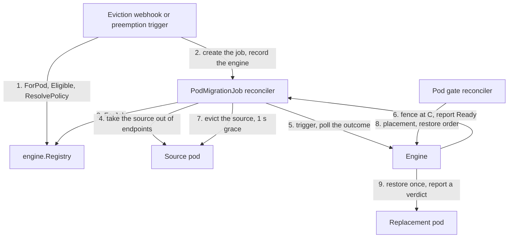

# Snapshot engine contract

**Status:** proposed. This is the design for #81, part of the CRIU engine epic (#76).

This document defines what the pod migration controller requires from a snapshot engine, the component that checkpoints a source pod and restores the checkpoint into a replacement pod. Today the only engine is [GKE Pod Snapshots](https://docs.cloud.google.com/kubernetes-engine/docs/concepts/pod-snapshots), on gVisor. A CRIU engine for `runc` pods comes next. An engine built on upstream pod checkpoint/restore ([KEP-5823](https://github.com/kubernetes/enhancements/issues/5823)) comes later.

## Summary

- **Today the contract is implicit.** An engine has to behave like GKE Pod Snapshots: serve its API objects, honor its restore annotation, and report failures through its Warning events. A second engine can only join by impersonating it, and the controller can't tell engines apart.
- **This document makes the contract explicit, in eleven clauses (C1–C11).** Each clause says what the controller relies on and what an engine must guarantee. Each clause gets a check: an invariant, a T2 scenario or a conformance test (#108).
- **No engine fully meets two of the safety clauses today.**
  - **Source fencing (C4):** after the checkpoint, the source must never serve or write again. On Pod Migration's gVisor path today, the kubelet restarts the stopped source with empty state, and that instance can serve client writes, which are then lost (#131).
  - **Exactly-once restore (C5):** a replacement is restored at most once.
- **Security is part of the contract (C10).** A restore runs a memory dump inside a privileged node component. Restore orders, archives and privileges therefore get explicit rules (#129).
- **The controller consumes the contract through a small `engine` package:** an `Engine` interface, a registry keyed by engine name, and optional capabilities. GKE Pod Snapshots is the first implementation, with no behavior change.

## Background: what the controller assumes today

Paths are under `controller/internal/`.

| Assumption | Where | Breaks for |
|---|---|---|
| A pod is eligible if its runtime class is in `--migratable-runtime-classes` (default `gvisor`, #77) | `webhook/eviction_webhook.go`, `controller/node_preemption_controller.go` | Engine limits such as container count or node readiness |
| A pod is eligible only if a Ready `PodSnapshotPolicy` with a manual trigger and `postCheckpoint: stop` selects it. That's a List call; with no match, migration is skipped (`MigrationSkippedNoPolicy`) | the same two files | Engines with their own policy objects (#135). It also hard-wires `Stopped` fencing into eligibility |
| The policy and storage config are GKE Pod Snapshots objects (`PodSnapshotPolicy` with a manual trigger and `postCheckpoint: stop`, `PodSnapshotStorageConfig`), one set per namespace | `controller/podmigration_controller.go` | Engines that select policies by label (#80) or serve their own API group (#135); two engines in one namespace |
| Checkpoint status is read from the trigger's and the `PodSnapshot`'s conditions | `snapshot/gke_provider.go` | Other condition vocabularies. The GKE-specific flap handling (#75, #95) also lives here |
| The restore order is the `podsnapshot.gke.io/ps-name` annotation | `controller/pod_gate_controller.go` | KEP-5823's `spec.restoreFrom`, or another API group |
| A restore succeeded if the replacement is Ready and no restore-failure Warning event was seen | `controller/podmigrationjob_controller.go` | Engines that emit no events, or that cold-start silently (#79) |
| A replacement's start failure is matched against gVisor's restore-crash signatures | `restore/` | `runc` pods (#132) |

## Goals and non-goals

Goals:

- One explicit, testable contract, with the engine selected per pod.
- No behavior change for gVisor from the registry step. The steps that change what gVisor users see (step 5's verdict reason and step 6's endpoint fence) say so, and update the guardrail tooling in the same PR.
- The CRIU engine, and later a KEP-5823 engine, join without a rewrite of the migration phases.

Non-goals:

- Engine internals: how an engine dumps processes, moves archives or restores them.
- API type changes in the first PRs. The engine is recorded in an annotation.
- Changing how evictions are intercepted.

## Terms

- **Source:** the pod being migrated.
- **Replacement:** the pod that the source's workload controller creates. The controller gates it until the checkpoint can be restored into it.
- **Checkpoint instant (C):** the moment after which the captured state no longer changes.
- **Restore order:** the controller's instruction to restore a given checkpoint into a given replacement.
- **Engines in this document:** GKE Pod Snapshots, for gVisor pods; the CRIU engine, which starts from the psengine prototype by Roman Arcea, being imported in #134; and a KEP-5823 adapter.

## The contract

### C1. Identity and targeting

- One named engine serves each PodMigrationJob. It is chosen before the checkpoint and never changes.
- An engine acts only on the triggers and restore orders addressed to it, pinned to the source pod's UID.
- **Resolution order:**
  1. The pod's runtime class decides which engines can serve it. Each engine declares the runtime classes it covers.
  2. If more than one engine covers that class, the PodMigration's engine choice for the class picks one (#80).
  3. Otherwise the cluster default for the class applies (`gvisor=gke-pod-snapshots`).

  So a namespace with gVisor and `runc` pods can use two engines at once, and a PodMigration never routes a pod to an engine that can't serve its runtime class.
- The controller records the engine on the job in the annotation `pod-migration.gke.io/engine`. A job without the annotation resolves to `gke-pod-snapshots`.
- **Each engine renders its own namespace resources.** For a PodMigration, every engine in use returns the policy and storage objects it needs (`NamespaceResources`). The PodMigration reconciler syncs them with owned-field patching (#143), and deletes them when the PodMigration is deleted or demoted (#98).
- **Engines that run side by side must not share objects.**
  - The CRIU engine moves to its own API group (#135).
  - The controller's snapshot provider is parameterized by group, and the restore-order annotation key follows the group.
- **Policy labels must survive syncs.** An engine that selects policies by label needs that label to stay on the generated policy, whether #80 renders it or an operator adds it. #143 makes the controller patch only the fields it owns, so the label stays.

### C2. Eligibility

- `Eligible(pod, node)` returns a verdict and a reason, from the pod and its source node as the caller's informer cache has them. It makes no API server calls, so it fits the eviction webhook's deadline. Both the eviction webhook and the preemption trigger call it.
- `ResolvePolicy(pod)` finds the engine's policy for the pod, also from the cache. Today that's the List of Ready, manual, `stop` `PodSnapshotPolicy` objects that select the pod. No policy means the migration is skipped (`MigrationSkippedNoPolicy`) and the eviction goes ahead cold. The engine owns this lookup, so an engine in its own API group finds its own policies, and `postCheckpoint: stop` becomes the GKE Pod Snapshots engine's requirement rather than a global one.
- It must be conservative. A wrong "yes" costs a `Refused` round trip at best, and silent state loss at worst.
- It covers the engine's shape limits (the CRIU engine v1 takes one container, and #114 adds sidecars) and the source node's readiness. The target node's readiness is a placement constraint (C8).
- It covers repeat migrations: a pod the engine restored must stay migratable by that engine, or be refused (#121).
- The operator allow-list (`--migratable-runtime-classes`) stays as a global gate on top.

### C3. Checkpoint outcomes

- The engine reports one of four outcomes:
  - `InProgress`.
  - `Ready`: the archive is durable where the target node can read it.
  - `Failed`: terminal.
  - `Refused`: terminal, and the source was never touched, so a cold eviction is safe (#78).
- The engine classifies its own conditions, so the controller stops parsing engine-specific reasons. It never reports a transient condition as terminal (#75, #95). For GKE Pod Snapshots the adapter can only approximate this, with a bounded window.
- Today `Refused` is a `Failed` status with the reason `refused` (#78). `snapshot.Phase` gains a `Refused` value, so the controller stops matching reason strings, and the job handles it as it does today. This lands in its own PR, because step 2 must not change test expectations.

### C4. Source fencing

**Rule.** After C, and until the source pod is deleted, no instance of the source may acknowledge a client request, or write to a volume or an external system. Fencing is a property of the processes, not of the pod object.

- **Freezing satisfies the rule.** A source frozen at C (with the cgroup freezer or the runtime's pause) doesn't exit, so the kubelet has nothing to restart.
- **Stopping or killing the source doesn't satisfy it.**
  - With `restartPolicy: Always`, the kubelet restarts a stopped container with empty state. On the gVisor path, that instance became Ready while the pod was terminating, stayed a serving endpoint, and acknowledged client writes that the restored copy never saw (#131).
  - An engine that kills the source only after the archive upload leaves it serving between C and the kill, and writes acknowledged in that window are lost.
  - Early tests of the CRIU prototype showed both effects.
- **Fencing has two layers.**
  1. **Controller, for every engine:** take the source out of serving endpoints before the trigger, for example with a readiness gate that the controller sets to False (#131). The controller creates the trigger only once the source's EndpointSlice entries show `serving: false`; kube-proxy's own sync can't be observed. A restarted instance then never becomes a serving endpoint.
     - This stops new Service connections. It doesn't cut established connections (keep-alive, gRPC, database sessions) or clients that dial the pod IP, and it doesn't stop writes to volumes or other systems. That's enough for the gVisor restart, which comes back in a new sandbox with a new IP, but not for an engine that leaves the source running or kills it late.
     - The costs: new connections stop reaching the source for the whole checkpoint, not only after it. And a fenced source isn't Ready, so a later eviction under `unhealthyPodEvictionPolicy: IfHealthyBudget` can be denied at the PDB's edge.
  2. **Engine:** fence the processes from C until the pod is deleted. Each engine declares a fencing mode:
     - `Frozen`: sufficient.
     - `Stopped`: not sufficient on its own, because the kubelet may restart a stopped container. Pod Migration uses GKE Pod Snapshots in this mode today; the controller-side fence (#131) keeps new Service connections away from the restarted instance.
     - `None`: not sufficient, because the source keeps running. This is KEP-5823 alpha.
- **Failure rule.** What happens to a fenced source after a failure depends on whether its state can still be trusted:
  - `Refused` never touches the source, so the controller puts it back into its endpoints. So does a `None` engine's failure, because the source kept running.
  - With a `Frozen` engine, the state is intact. The engine thaws the source before it reports `Failed`, on every failure path and after its own restart, and the controller then puts it back. This needs care: a cancelled or timed-out containerd checkpoint can leave the task frozen, because containerd resumes it with the caller's context, which has already ended (#106).
  - With a `Stopped` engine, the controller can't tell whether C has passed once the trigger is accepted, and after C the sandbox is gone: a kubelet restart brings back an empty instance. So the controller keeps the fence and cold-evicts the source. Putting it back would serve exactly the empty instance of #131.
  - The controller puts a source back only after the engine confirms the cancel (C9), or when nothing can stop the source any more. Today the failure and timeout paths delete the trigger and mark the job `Failed` at once, and #106 shows the engine can still stop the source after that.
- Once the outcome is `Ready`, the controller evicts the source with a 1 s grace period. The deletion ends the engine's fencing duty.

### C5. Restore order and exactly-once restore

- The controller issues one restore order per replacement, through the engine: `ps-name` today, `spec.restoreFrom` for KEP-5823. The engine also defines the explicit cold-start bypass, which the controller applies when it releases a replacement without a restore: `ps-name: ""` today.
- **Rule.** A replacement is restored from a checkpoint at most once, and its outcome is recorded once. A retried reconcile, a conflict on the outcome write, a container restart or an engine restart must never re-apply the checkpoint to a pod that has already run restored code. A second restore rolls the application back after it has already served clients.
- **The controller's half exists.** Invariant I1 (`AtMostOnceRestore`) and the single-use gate stop a second pod from consuming the same checkpoint.
- **The engine owns the other half.** Neither of those can see a second restore inside the same pod. The engine guards the restore with a durable marker, written before restoring under optimistic concurrency, not with in-memory state.
- Together with C6, the path is exactly-once: at most once on both sides, and at least once or a declared cold start.

### C6. Restore outcome signal

- For each replacement, the engine reports one terminal verdict with its evidence: `Restored`, `ColdStart` (with a reason) or `Failed`. While the restore is still running, the engine reports `InProgress`, which isn't a verdict, and the controller keeps polling.
- Only a verdict that the engine confirmed may set `RestoreVerified`. Having no verdict when the restore deadline passes (5 minutes today) is not a success.
- GKE Pod Snapshots keeps today's inference: the replacement is Ready, and no restore-failure Warning event has been seen since restoring started. The job records that verdict as inferred, with its own reason (#79). That changes the reason gVisor users see, so step 5 updates the tooling that keys on `RestoreVerified` in the same PR: pmprofiler's `--assert-verdict-matches-data`, `run_guardrail_t2.sh` and the T3 fixtures.
- The verdict must describe the application, not the engine's wrapper. #121 shows a `restored` signal for a pod whose application wasn't running.

### C7. Restore failure classification

- When a replacement fails to start, only the engine that serves the pod's runtime class may classify the failure. A matched signature deletes the pod and falls back to a cold start, so a wrong match is destructive (#132).
- The controller builds the engine set once. The PodMigrationJob reconciler and invariant I9 share it.
- A failure that no engine claims is `FailureUnrecognized`: reported, never acted on.

### C8. Placement constraints

- Before the replacement is scheduled, the engine states hard constraints on the target node: CPU or machine compatibility (#14), the engine's readiness on the node, and where the checkpoint can be read.
- The controller turns these constraints into scheduling constraints when it releases the gate. Placement stays an orchestration task; the facts come from the engine.
- If no node can meet them, the controller degrades explicitly: after a deadline, it drops the constraints and the restore order together, and the replacement starts cold (#14). Otherwise the replacement sits unschedulable, and the restore deadline reports `SucceededWithoutRestore` for a pod that might still restore later.

### C9. Cancellation and cleanup

- **Cancel.** Deleting the engine's trigger means: start nothing new against the source, and stop what can still be stopped. The engine confirms the cancel, so the controller knows whether the source is safe to put back (C4, #106).
- **Node cleanup.** The engine cleans up everything it created on the node for a restore, on success and on failure (#126, #128). Restored processes are charged to the pod (#127).
- **Archives.** The engine owns archive garbage collection. The controller tells it when a checkpoint is no longer needed: once the restore is verified, or when the job fails terminally, with an optional retention period for debugging (#107).

### C10. Security

A checkpoint is a memory dump, which can hold tokens and keys, and a restore runs inside a privileged node component. Every engine must meet these requirements, from #129:

- **R1. Authorization.**
  - Honor only the restore orders the controller created for a PodMigrationJob, for a replacement tied to that job.
  - Only the controller's identity may set or change restore orders, enforced for example by a ValidatingAdmissionPolicy on `request.userInfo`.
  - Never treat a user-supplied engine annotation as already processed.
  - R1 covers the restore orders of migrations. A restore requested outside a migration is out of scope; for example, a Kubeflow workspace restore sets `ps-name` itself, and the controller deliberately leaves it alone (#55). An engine that supports such restores must authorize them itself.
- **R2. Provenance.**
  - The engine signs or MACs the archive manifest with a key that workloads can't read.
  - The manifest binds the cluster UID, the job UID, the source pod UID and the archive digests.
  - The restore side verifies it before it downloads or extracts anything.
- **R3. No privilege gain.**
  - The restored container's security-relevant settings come from the replacement pod, not from the archive: user and groups, capabilities, `noNewPrivileges`, seccomp, AppArmor/SELinux, devices (including CDI), privileged mounts, masked and read-only paths, and host namespaces.
  - The engine never pulls or tags an image that the archive names.
  - It refuses an archive that asks for more, and fails closed to a cold start.
- **R4. Node posture.**
  - The engine doesn't enable restore on a node whose runtime has a known unsafe restore path. It reports the node as not ready, with a reason.
  - For containerd, that path is restore through `CreateContainer` ([GHSA-p7v4-vr35-mj6f](https://github.com/containerd/containerd/security/advisories/GHSA-p7v4-vr35-mj6f)). It is on in versions ≥2.1.0 <2.2.7 and ≥2.3.0 <2.3.4, which have no off switch, or when `enable_experimental_restore_via_create = true`.
- **R5. Archive handling.** Archives are handled like Secrets: bucket access only for the engine's identity, an option for customer-managed encryption keys, and retention and garbage collection (C9).
- **R6. Hardened unpacking.**
  - Filesystem diffs are applied only through the runtime's hardened archive code, into a mounted snapshot.
  - Bundles are unpacked as directories and regular files only, with caps on total bytes and entry count.

R4 gates the first release (#110). Until R1–R4 land, the CRIU engine is for test clusters only.

### C11. Observability

Every engine decision that the controller acts on is visible on the PodMigrationJob, and in metrics with an `engine` label: the engine name, the checkpoint outcome and its reason, the fencing mode, the restore verdict and its evidence, and the cancel acknowledgement.

## The engines against the contract

The KEP-5823 column follows the KEP text; its implementation hasn't merged.

| Clause | GKE Pod Snapshots (gVisor) | CRIU engine (prototype) | KEP-5823 (alpha) |
|---|---|---|---|
| C1 Identity | The only engine; API group `podsnapshot.gke.io` | Same API group as GKE Pod Snapshots, and serves only policies labeled `pod-migrate.io/engine=criu`. Its own group comes in #135 | Built-in `PodCheckpoint`; `spec.sourcePodUID` pins the source |
| C2 Eligibility | Runtime class `gvisor` | One container and a criu-ready node. No runtime-class check | The kubelet checks at checkpoint time |
| C3 Outcomes | Best effort: the provider suppresses a terminal `Ready` for a bounded window while sub-conditions progress (#75, #95), which may not cover every flap (see #122). `Refused` is terminal | `Ready` only after the archive is uploaded and verified; policy refusals are `Refused` | One `Ready` condition; `SourcePodReplaced` maps to `Refused` |
| C4 Fencing | `Stopped`, the mode Pod Migration uses today; needs the controller-side fence (#131) | `Stopped`, after the upload | `None`: the source keeps running |
| C5 Exactly-once | Unverified. The replacement keeps `ps-name` for life, and #131 saw sandboxes recreated, so a recreated sandbox might restore again: a conformance case for #108 | Not idempotent: after a conflict on its outcome write, the retry restored the replacement again | Once by design: `spec.restoreFrom` is ignored once containers run |
| C6 Restore signal | Inferred from the absence of Warning events | A pod annotation. A skipped restore leaves none | The pod's `Restoring` condition and a restore event |
| C7 Classification | gVisor signatures | None yet. gVisor's signatures are applied to its pods today (#132) | The reason on the pod's `Restoring` condition |
| C8 Placement | None declared. A different machine shape can fail the restore (#14) | Checks the CPU family at restore time, too late to reschedule | Same node only |
| C9 Cancel, cleanup | The trigger is deleted; abort and archive GC are unverified | Deleting the trigger doesn't stop the work (#106); no GC (#107) | `PodCheckpoint` outlives the source; GC is a non-goal |
| C10 Security | Managed by GKE | R1–R6 open (#129) | R1 and R3 in-tree (a `restore` verb checked at admission, and pod-template equality). Archives stay node-local |

## How the controller consumes the contract

```go
package engine // controller/internal/engine

// Engine is one checkpoint/restore engine.
type Engine interface {
	// C1: the registry key, recorded on the job, and the runtime classes it serves.
	Name() string
	RuntimeClasses() []string
	// C1: the policy and storage objects it needs in a PodMigration's namespace.
	NamespaceResources(pm *pmv1alpha1.PodMigration) ([]*unstructured.Unstructured, error)
	// C2: pure; node is the source node, from the caller's cache.
	Eligible(pod *corev1.Pod, node *corev1.Node) Verdict
	// C2: the policy that would serve the pod, from the cache; nil means skip the migration.
	ResolvePolicy(ctx context.Context, pod *corev1.Pod) (*PolicyRef, error)
	// C1, C3, C9: the existing seam. C7: the existing restore-crash classifiers.
	Snapshots() snapshot.Provider
	RestoreFailures() []restore.Engine
	// C4, C5: declared, and checked by invariants and T2.
	Guarantees() Guarantees
}

type Verdict struct {
	OK     bool
	Reason string
}

type PolicyRef struct{ Group, Kind, Name string }

type FencingMode string // "Frozen", "Stopped" or "None" (C4)

type Guarantees struct {
	Fencing     FencingMode
	RestoreOnce bool // C5
}

type RestoreOutcome string // C6

const (
	RestoreInProgress RestoreOutcome = "InProgress" // not a verdict: keep polling
	Restored          RestoreOutcome = "Restored"
	ColdStart         RestoreOutcome = "ColdStart"
	RestoreFailed     RestoreOutcome = "Failed"
)

type RestoreVerdict struct {
	Outcome  RestoreOutcome
	Reason   string
	Evidence string // the condition, annotation or event the verdict came from
}

// Optional capabilities. The controller type-asserts them and keeps today's
// behavior when one is missing.
type RestoreOrderer interface { // C5
	OrderRestore(pod *corev1.Pod, job *pmv1alpha1.PodMigrationJob) error
	OrderColdStartBypass(pod *corev1.Pod) error // release without a restore
}
type RestoreVerifier interface { // C6, #79
	VerifyRestore(ctx context.Context, job *pmv1alpha1.PodMigrationJob, pod *corev1.Pod) (RestoreVerdict, error)
}
type PlacementAdvisor interface { // C8, #14
	Placement(ctx context.Context, job *pmv1alpha1.PodMigrationJob) ([]corev1.NodeSelectorRequirement, error)
}
type Canceler interface { // C9, #106
	Cancel(ctx context.Context, job *pmv1alpha1.PodMigrationJob) (done bool, err error)
}

// Registry maps engine names to engines, and holds the cluster default engine
// for each runtime class.
type Registry struct{}

func (r *Registry) Register(e Engine) error
func (r *Registry) ForPod(pod *corev1.Pod, pm *pmv1alpha1.PodMigration) (Engine, bool) // C1 resolution order
func (r *Registry) ForJob(job *pmv1alpha1.PodMigrationJob) (Engine, error)             // annotation, else the default
```



- **GKE Pod Snapshots is the first implementation, and nothing changes for it.**
  - `Name()` is `gke-pod-snapshots`, and `RuntimeClasses()` is `gvisor`. `NamespaceResources` is today's PSP and PSSC rendering, and `ResolvePolicy` is today's lookup of a Ready, manual, `stop` policy. `Snapshots()` is today's provider, `RestoreFailures()` is today's gVisor classifier, `Eligible` is today's runtime-class check, `OrderRestore` is today's `ps-name` stamping, and `OrderColdStartBypass` is today's `ps-name: ""`. `Guarantees` is `{Stopped, RestoreOnce: false}`, report-only.
  - No existing test expectation changes, and T1 and T2 still pass.
- **The package composes with the existing seams instead of replacing them.**
  - `snapshot.Provider` and `restore.Engine` stay, and `Engine` hands them out.
  - The reconcilers' existing override fields stay, for tests.
  - Each new clause arrives as an optional capability in its own PR. An engine without the capability keeps today's behavior.
- **A KEP-5823 engine is an adapter.** Its provider creates a `PodCheckpoint`, its `OrderRestore` sets `spec.restoreFrom`, and its verifier reads the pod's `Restoring` condition.

## Guardrails

Three new checks follow the style of the existing invariants ([invariants.md](../invariants.md)). Two are controller-side rules, and each gets its number when its `invariant/` PR merges (#85). `RestoreAppliedOnce` is checked only by T2 and the conformance suite.

| Check | T1, controller side | T2, application side |
|---|---|---|
| `SourceFencedAfterCheckpoint` | From the trigger until the source is deleted, the source's fence condition stays False: the readiness-gate condition in pod status (#131), which needs no EndpointSlice informer. For an engine that declares `Frozen`, no source container starts after the trigger either | The write-continuity probe (#103): every write acknowledged after C is in the restored copy, and no read is served by an empty instance |
| `RestoreAppliedOnce` | None: I1 and I2 already cover the controller's side | No rollback after a restored instance has acknowledged writes. Conformance cases (#108): a conflict on the outcome write, and a recreated sandbox, must not restore again |
| `RestoreOutcomeConfirmed` | `RestoreVerified` requires the job to record engine-confirmed evidence. An inferred verdict carries its own reason (C6), so the check reads only the job | A workload whose restore is skipped must not end `RestoreVerified` |

- `--invariant-mode` defaults to `disabled`, so production behavior doesn't change.
- T1 runs in strict mode, so each new rule must stay silent on today's scenarios. That's why `SourceFencedAfterCheckpoint` lands with the endpoint fence (#131).
- `ReconcileSnapshot` doesn't carry what these rules read yet: the engine's identity, the fence condition, the recorded evidence. It's built outside `invariants/**`, so each rule needs a plumbing PR on a normal branch first (or the `allow-invariant-cochange` label), then its `invariant/` PR.
- The existing I1 (`AtMostOnceRestore`) and I2 (`NoSilentColdStart`) read the `podsnapshot.gke.io/ps-name` annotation. For an engine with another API group or `spec.restoreFrom` they would miss restores or report false violations, so they read the job's engine's restore order once engines resolve per pod (step 3).
- The engine conformance suite (#108) runs every clause for each engine, including the negative security tests from #129.

## Who owns what

| Controller: orchestration | Engine: checkpoint and restore |
|---|---|
| Intercepting evictions | Checkpoint mechanics, durability and transport |
| The operator allow-list; asking the engine about eligibility and its policy | Deciding `Refused`; finding and rendering its policy and storage objects |
| Choosing and recording the engine for each job | Acting only on the orders addressed to it |
| Phases and timeouts | Classifying its own outcomes |
| Taking the source out of endpoints before the trigger, and keeping it out after a failure past C with a `Stopped` engine; evicting it after `Ready` | Fencing the source's processes from C until deletion; thawing a `Frozen` source on failure; confirming a cancel |
| Gating the replacement; one checkpoint per replacement (I1) | Restoring at most once; recording the outcome once |
| Placement and verification policy | Stating constraints; a positive verdict with evidence |
| Deciding to cancel; guardrails | Honoring the cancel; archive GC; R1–R6 |

## Upstream: KEP-5823

- **Status on 2026-10-13:** alpha targets Kubernetes v1.38. The implementation PR, kubernetes/kubernetes#140186, is on hold, and the cross-node migration follow-on hasn't been filed.
- **What alpha gives a migration engine:** a checkpoint of the whole pod at one instant, a positive restore signal and a once-only restore.
- **What it doesn't give:** cross-node restore, or a fenced source. The source keeps running, and a restore is accepted only on the checkpoint's node. Drain migration can't rely on it yet, so cross-node transport and fencing stay the engine's job.
- **How we adopt it:** as an adapter behind this contract, once the feature is beta, containerd in GKE node images supports it, and GKE exposes it (#111).
- **If the migration follow-on adds a stopped source and remote checkpoints:** the adapter gains a fencing mode and cross-node restore, and the controller doesn't change. A stopped source meets C4 only if the kubelet never restarts it. #131 is the reason to raise this in upstream review.
- **If EvictionRequest (KEP-4563) lands:** only interception changes. Engines aren't affected, because `Eligible` stays pure.

## Alternatives considered

| Alternative | Decision |
|---|---|
| Keep "behave like GKE Pod Snapshots" | Rejected. Engines must impersonate its objects and events, and a silent cold start ends `RestoreVerified` |
| One new interface that replaces `snapshot.Provider` and `restore.Engine` in a single PR | Rejected. It's a large diff through the migration phases, and hard to prove behavior-neutral for gVisor |
| Engine capabilities as a CRD (an `EngineClass`) | Deferred. It needs new API types, and a CRD can back the Go interface later |
| Fence only in the controller | Partly adopted. The controller takes the source out of endpoints (#131), but it can't cut established connections or stop processes from writing to volumes or other systems, so process fencing stays with the engine |
| Wait for KEP-5823 | Rejected as a blocker. Alpha has no fencing and no cross-node restore |

## Compatibility

- **gVisor:** the registry PR changes nothing. Capabilities are optional, guarantees are report-only, and the new invariants run only when `--invariant-mode` isn't `disabled`. The endpoint fence (#131) does change gVisor behavior, so it ships in its own PR.
- **Verdict reason:** step 5 gives the inferred GKE Pod Snapshots verdict its own reason (C6). That's a visible change, so the same PR updates the guardrail tooling that keys on `RestoreVerified`.
- **API:** no change. The engine is recorded in a job annotation, so there's no CRD change and no regenerated deepcopy code.
- **Upgrade and downgrade:** jobs without the annotation resolve to `gke-pod-snapshots`, and an older controller ignores the annotation.
- **Flags:** `--migratable-runtime-classes` keeps its meaning. The map from runtime class to engine is new, and defaults to `gvisor=gke-pod-snapshots`.
- **Metrics:** the `engine` label (C11) changes the label sets of existing metrics. Queries that aggregate across labels keep working; alerts and recording rules that match exact label sets need a review when it lands.

## Delivery

| Step | Scope | Issue |
|---|---|---|
| 1 | This document | #81 |
| 2 | The `engine` package, the registry and the GKE Pod Snapshots engine, with no behavior change | #145 |
| 3 | Per-pod engine resolution and targeting; the engine annotation | #80 |
| 4 | Restore failure classification by runtime class | #132 |
| 5 | Positive restore verification | #79 |
| 6 | Take the source out of endpoints before the trigger | #131 |
| 7 | The CRIU engine in the repo, with its own API group | #134, #135 |
| 8 | Cancellation; archive garbage collection | #106, #107 |
| 9 | Placement constraints | #14 |
| 10 | Security requirements; the conformance suite | #129, #108 |

The two controller-side rules land as `invariant/` PRs, each after its plumbing PR: `SourceFencedAfterCheckpoint` with step 6, and `RestoreOutcomeConfirmed` after step 5. The I1/I2 change follows step 3.

Step 6 keeps a `Stopped` engine's source fenced on every failure path. Putting a source back into its endpoints waits for confirmed cancellation (step 8).

## Open questions

1. **Fencing policy.** Should the controller refuse to migrate with a `None` engine unless the workload opts in? And what mode should new engines get by default? Enforcement starts off, so gVisor isn't affected.
2. **The endpoint fence (#131).** A readiness gate must be in the pod spec when the pod is created, so pods created before the upgrade don't have it. Today's replacement webhook only mutates pods that have an assigned job, so injecting the gate into first-generation pods needs a new mutating path for opted-in pods. A label flip works on existing pods, but it must not touch the workload's selector. Which one should we use, or both?
3. **A positive signal for GKE Pod Snapshots.** Is there a condition or annotation we can read? If not, it stays on the inferred path.
4. **Engine selection flags.** One flag (`--runtime-class-engines=gvisor=gke-pod-snapshots,@default=criu`), or one flag per engine?
5. **Recording the engine.** An annotation for good, or a typed `status.engine` field later?
6. **KEP-5823 restore orders.** The KEP checks that a `spec.restoreFrom` pod's spec equals the checkpointed pod's spec, but our replacement webhook adds a scheduling gate and annotations. Are the two compatible?
